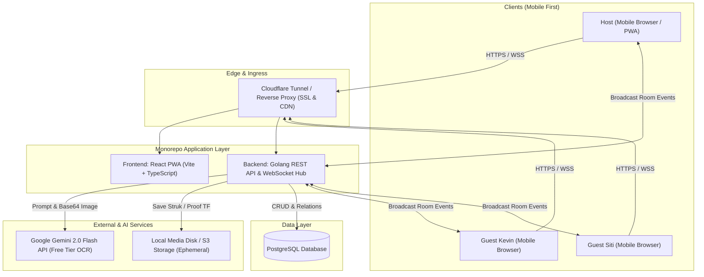

# 🏗️ 01. System Architecture & Deployment
**PaTo (Pay Together) — Monorepo Architecture Specification**

---

## 1. High-Level Architecture Overview



---

## 2. Tech Stack Breakdown

### Frontend (React PWA)
* **Framework**: React 18 / 19 with Vite.
* **Language**: TypeScript.
* **Styling**: Vanilla CSS / Tailwind with predefined custom tokens (`--pato-blue-600`, etc.).
* **State & Sync**: Lightweight state management (Zustand / TanStack Query) + Native WebSocket Client.
* **Storage**: `localStorage` untuk menyimpan `guest_token`, preferensi bahasa (`ID`/`EN`), dan riwayat room aktif.
* **Capabilities**: PWA Web Manifest (Installable to Home Screen), Web Share API (`navigator.share`), Canvas API (Generate Kartu Struk PNG).

### Backend (Golang)
* **Language**: Go 1.22+.
* **Router & Framework**: Chi (`github.com/go-chi/chi/v5`) atau Echo (`github.com/labstack/echo/v4`).
* **Database Driver**: `pgx/v5` / `sqlx` terhubung ke PostgreSQL.
* **WebSocket Engine**: `gorilla/websocket` atau `coder/websocket` dengan Room Hub pattern (satu channel per `room_code`).
* **AI OCR Service**: Google Generative AI Go SDK (`github.com/google/generative-ai-go`) model `gemini-2.0-flash`.

---

## 3. Deployment Strategy (Hybrid Lifecycle)

### A. Development Phase (Home Server Setup)
* **Hardware**: Laptop Linux bekas milik developer.
* **Networking**: **Cloudflare Tunnel (Zero Trust / `cloudflared`)**.
  - Mengabaikan CGNAT / blokir port dari ISP lokal (Indihome/FirstMedia).
  - Mengamankan koneksi dengan SSL/TLS otomatis gratis dari Cloudflare.
  - Domain publik (misal: `dev.pato.app` atau `pato.yourdomain.com`).
* **Docker Compose**: Menjalankan container PostgreSQL lokal dan backend Golang.

### B. Production MVP Phase (High-Reliability Kasir)
* **Infrastructure**: VPS Linux murah (Hetzner Cloud / Contabo / Domainesia Rp 50.000–70.000/bulan).
* **Uptime Guarantee**: 99.9% uptime agar user tidak mengalami koneksi putus saat berdiri di meja kasir restoran jam 10 malam.
* **Single Binary Deployment**: Golang di-compile menjadi binary statis tunggal; static assets React disajikan langsung oleh Go atau via Nginx.

---

## 4. AI Struk OCR Architecture (Gemini Flash)

1. **Upload**: Host mengambil foto struk via kamera browser HP ➔ dikirim via `multipart/form-data` ke backend endpoint `/api/rooms/ocr`.
2. **Compression**: Backend/Frontend mengompresi gambar ke WebP/JPEG max 1200px (menghemat bandwidth).
3. **Structured Prompt**: Backend mengirimkan gambar ke Gemini 2.0 Flash dengan skema output JSON ketat:
   ```json
   {
     "items": [
       {"name": "Salmon Sashimi", "unit_price": 35000, "quantity": 2},
       {"name": "Ocha Dingin", "unit_price": 10000, "quantity": 4}
     ],
     "subtotal": 110000,
     "tax_amount": 11000,
     "service_amount": 5500,
     "discount_amount": 0,
     "grand_total": 126500
   }
   ```
4. **Free Tier Safeguard**: Google AI Studio memberikan kuota gratis **15 Request/Menit** dan **1.500 Request/Hari**. Backend membatasi maksimal 2-3 kali scan struk per room.

---

## 5. Ephemeral Media Purge (Storage Management)

* File struk asli dan screenshot bukti transfer m-banking disimpan di disk lokal backend (`/storage/receipts/` & `/storage/proofs/`).
* **Purge Triggers**:
  1. *Manual*: Host menekan tombol **"Tutup Grup (Selesai)"** di dashboard.
  2. *Automatic Worker*: Cron worker Go berjalan tiap 24 jam untuk menghapus file fisik yang terkait dengan room berstatus `CLOSED` atau berumur > 7 hari.
  3. Data angka teks, rekap, dan history tetap tersimpan di database PostgreSQL.
