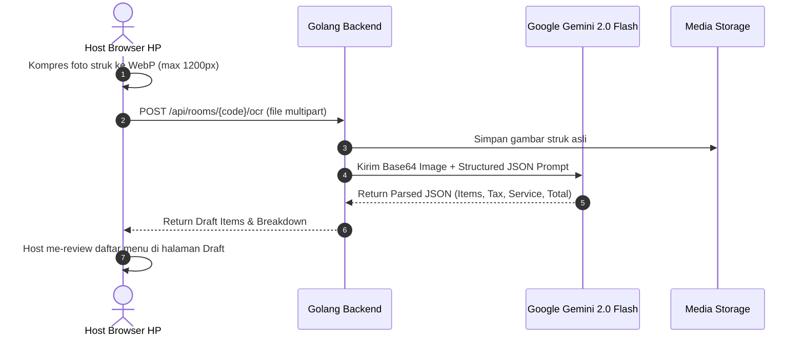

# 📸 F02: Hybrid Receipt Input & Gemini OCR Scanner
**Dokumen Spesifikasi Fitur — PaTo (Pay Together)**

---

## 1. Ringkasan Fitur
Memungkinkan Host memasukkan daftar menu secara instan melalui foto struk kasir berbasis kecerdasan buatan (**Google Gemini 2.0 Flash API**) atau menambahkan/mengedit item secara manual via form *Fast-Tap*.

## 2. User Stories
* **Host**: "Gue capek ngetik 25 piring sushi satu per satu di HP. Gue mau tinggal foto struk kasir, terus dalam 3 detik semua nama makanan dan harganya otomatis masuk ke list."
* **Guest**: "Gue mau bisa ngecek foto struk asli dari kasir biar gue yakin harga yang ditagih sama Host bukan harga yang dimarkup."

---

## 3. Alur Kerja OCR (Gemini 2.0 Flash)



---

## 4. Structured Prompt & Gemini Schema

Prompt sistem yang dikirimkan backend Golang ke model `gemini-2.0-flash`:

```text
Kamu adalah asisten keuangan ahli pembaca struk restoran Indonesia.
Tugasmu adalah membaca gambar struk kasir terlampir dan mengekstrak daftar item makanan, minuman, kuantitas, harga satuan, pajak PB1/PPN, service charge, dan diskon.

Aturan Penting:
1. Normalisasi nama makanan singkatan khas resto Indo (contoh: 'Slmn Roll' -> 'Salmon Roll', 'Ocha Dngn' -> 'Ocha Dingin').
2. Pisahkan baris Pajak Resto (PB1/PPN) dan Service Charge dari daftar item makanan.
3. Hitung harga satuan (unit_price) jika struk menampilkan total per baris.
4. Output WAJIB berupa JSON murni tanpa markdown formatting pembuka/penutup.
```

### Response JSON Schema yang Diharapkan:
```json
{
  "items": [
    {
      "name": "Salmon Sashimi",
      "quantity": 2,
      "unit_price": 35000,
      "total_price": 70000
    },
    {
      "name": "Ocha Dingin",
      "quantity": 4,
      "unit_price": 10000,
      "total_price": 40000
    }
  ],
  "subtotal": 110000,
  "tax_rate_percent": 10.0,
  "tax_amount": 11000,
  "service_rate_percent": 5.0,
  "service_amount": 5500,
  "discount_amount": 0,
  "grand_total": 126500
}
```

---

## 5. Fitur Manual Fast-Tap & Draft Review

* **Draft Review**: Sebelum membuka room untuk umum, Host berada di layar review untuk memverifikasi bahwa:
  $$\text{Subtotal} + \text{Pajak} + \text{Service} - \text{Diskon} = \text{Grand Total}$$
  Jika angka tidak cocok, ada peringatan kuning: *"Total hitungan berbeda Rp 2.000 dari struk kasir. Silakan cek ulang."*
* **Manual Add Item**: Form input cepat di bagian bawah:
  `[ Nama Makanan ] [ Harga Satuan ] [ - ] [ Qty ] [ + ] [ Tambah Item ]`
* **Edit & Delete**: Setiap baris item hasil scan AI bisa di-klik untuk diubah nama, harga, atau dihapus jika salah baca.

---

## 6. Single Source of Truth (Receipt Zoom Modal)
* Foto struk asli yang diunggah Host disimpan dan link-nya disematkan di header room.
* Seluruh member memiliki tombol: **"Lihat Foto Struk Asli 📸"**.
* Menampilkan modal full-screen gambar struk dengan dukungan gesture pinch-to-zoom di HP, memastikan transparansi penuh.
